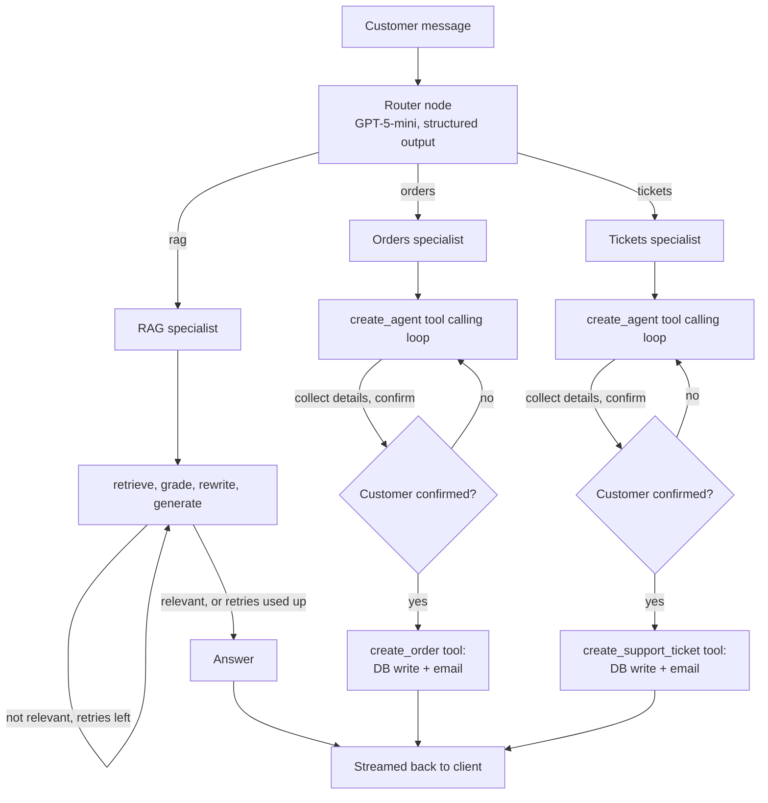

# Architecture
 
## Overview
 
The backend uses a LangGraph supervisor pattern that I wrote by hand. A router node classifies each customer message and passes it to one of three specialist subgraphs. I skipped the prebuilt `langgraph-supervisor` library on purpose. Building it myself gave me more control over the routing logic and the streaming behavior, and I wanted to learn how it works.
 

 
## The RAG specialist
 
This is the part of the system that behaves most like an agent. It does not retrieve once and generate. It runs an explicit loop instead.
 
1. Retrieve: embed the query and search Pinecone for the top 3 chunks.
2. Grade: an LLM call with structured output decides whether those chunks contain enough to answer the question.
3. Rewrite: if the chunks are not good enough and a retry is left, the LLM rewrites the search query and the loop goes back to retrieve. By default there is one retry.
4. Generate: write the final answer using only the retrieved context. The prompt tells the model to say so when the context is not enough, instead of guessing.
## Orders and tickets specialists
 
Both are built with LangChain's `create_agent`, which is a standard tool calling ReAct loop. I did not build a custom graph here because the job is simple. The agent chats with the customer to fill in the required details, then decides when to call a tool. That is exactly what a tool calling agent is made for.
 
The part that needs the most care is the line between confirming and executing. The agent collects every required field through conversation, shows a summary, and waits for an explicit yes. The `create_order` and `create_support_ticket` tools take every field as a required argument, so they cannot be called with incomplete data. The system prompt also forbids calling them before the customer has confirmed. Once a tool does run, everything inside it, the database write and then the email, is plain Python with no LLM decisions involved.
 
## Memory
 
Postgres handles two separate things, both in the same database instance.
 
The first is business data. The `orders` and `support_tickets` tables are managed with SQLAlchemy 2.0 (async) and versioned with Alembic migrations.
 
The second is conversation checkpoints. LangGraph's `AsyncPostgresSaver` stores the full message history for each `thread_id`, and the `thread_id` lives in a browser cookie. Every time the graph runs, it loads the earlier state for that `thread_id` before responding, so a conversation survives page refreshes and server restarts. This uses its own schema that Alembic does not manage. It gets created by `checkpointer.setup()` when the application starts.
 
## Ingestion pipeline
 
Ingestion is a standalone script, `ingestion/load_to_pinecone.py`. It is not part of the running API. I run it by hand whenever the reference PDF changes.
 
1. Extract the text from the PDF with `pypdf`.
2. Split it into chunks with `RecursiveCharacterTextSplitter`, using 500 characters per chunk and 100 characters of overlap.
3. Embed each chunk with `text-embedding-3-small` through Azure OpenAI's v1 API.
4. Upsert the vectors into Pinecone in batches of 50. Chunk IDs are deterministic, a hash of the source and the chunk index, so running the script again on an updated PDF overwrites the existing vectors and does not create duplicates.
## Model selection
 
The idea is to match the model to the task, with cheaper models for simple classification and stronger ones where answer quality matters. At the moment every chat role runs on GPT-5-mini.
 
| Role                                          | Model                  |
|-----------------------------------------------|------------------------|
| Router (intent classification)                | GPT-5-mini             |
| RAG (grading, rewriting, generation)          | GPT-5-mini             |
| Orders and tickets (conversation, tool calls) | GPT-5-mini             |
| Embeddings                                    | text-embedding-3-small |
 
All Azure OpenAI calls use the v1 API, which needs a `base_url` and an `api_key` but no `api_version`. They go through `ChatOpenAI` and `OpenAIEmbeddings` from `langchain_openai`, pointed at the Azure endpoint. I did not use the older versioned `AzureChatOpenAI` client.
 
## Streaming
 
The FastAPI `/chat` endpoint streams with `graph.astream(..., stream_mode="messages")`. That emits LLM tokens as they are generated, including from nodes that call `.invoke()` internally and not only `.stream()`. The router produces its own structured output tokens, and those are filtered out of the stream using `metadata["langgraph_node"]`. Customers only see the specialist's reply and never the routing decision.
 
## Frontend
 
The frontend is a Next.js App Router storefront with a chat widget embedded in it. The widget and the storefront share state through a React context called `ChatWidgetContext`. Because of that, the "Ask about ordering" button on a product card can open the widget and send a real order message to the agent. The storefront and the agent are actually connected, not just sitting next to each other on the page.
